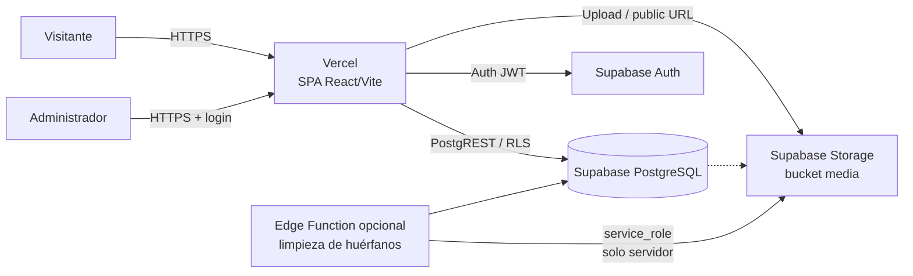
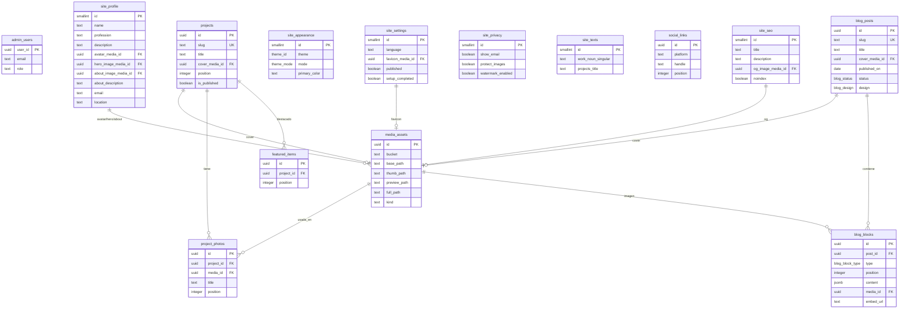

# Visora — Arquitectura definitiva de Supabase

> **Estado:** documento de diseño. No se ha implementado nada todavía.
> **Alcance:** modelo de datos, Storage, Auth/RLS, migraciones/seed y capa de acceso desde React.
> **Premisa:** cada cliente es una instalación independiente (un proyecto Supabase, un deploy de Vercel y un dominio propios). No hay SaaS multi-tenant ni `tenant_id`.

---

## Índice

1. [Arquitectura general](#1-arquitectura-general)
2. [Inventario del estado actual](#2-inventario-del-estado-actual)
3. [Mapeo localStorage → modelo SQL](#3-mapeo-localstorage--modelo-sql)
4. [Diagrama relacional](#4-diagrama-relacional)
5. [Modelo de tablas](#5-modelo-de-tablas)
6. [Storage](#6-storage)
7. [Auth y RLS](#7-auth-y-rls)
8. [Migraciones, seed y entornos](#8-migraciones-seed-y-entornos)
9. [Capa de conexión con React](#9-capa-de-conexión-con-react)
10. [Orden de implementación](#10-orden-de-implementación)
11. [Riesgos y ambigüedades](#11-riesgos-y-ambigüedades)
12. [Apéndice: decisiones cerradas](#12-apéndice-decisiones-cerradas)

---

## 1. Arquitectura general

### 1.1 Principio de instalación independiente

Visora es una aplicación/plantilla que se **clona por cliente**. Cada instalación tiene:

| Recurso | Propiedad |
|---|---|
| Repositorio | Copia del repositorio de Visora por cliente (o rama/entorno separado). |
| Vercel | Proyecto propio del cliente, con su dominio. |
| Supabase | Proyecto propio del cliente (PostgreSQL + Auth + Storage). |
| Datos | Aislados físicamente: no se comparte base de datos entre clientes. |
| Admin | Usuario administrador creado en ese proyecto Supabase. |
| Dominio | Dominio del cliente, configurado en Vercel. |

Consecuencias de diseño:

- **No existe `tenant_id`**, ni `site_id`, ni resolución de tenant por dominio/subdominio.
- Las tablas de configuración son **singleton** (`id = 1`) porque solo hay un sitio por instalación.
- Las políticas RLS no filtran por inquilino; filtran por **estado de publicación** y por **rol admin**.
- El contenido demo de Alex Morgan nunca forma parte del seed de producción.

### 1.2 Diagrama de despliegue



- El frontend es una **SPA** (Vite). No hay SSR ni API intermedia obligatoria.
- El acceso a datos se hace con el cliente oficial `@supabase/supabase-js` usando la **clave publicable** (`anon` / publishable key).
- La `service_role` **nunca** se expone en el frontend ni en variables `VITE_*`. Solo puede usarse en scripts locales de administración o en una Edge Function server-side.

### 1.3 Variables de entorno

```env
# Frontend (públicas por diseño; RLS protege los datos)
VITE_SUPABASE_URL=https://<project-ref>.supabase.co
VITE_SUPABASE_ANON_KEY=<publishable-key>
```

Reglas:

- No usar `SUPABASE_SERVICE_ROLE_KEY` en el repositorio ni en Vercel como variable `VITE_*`.
- Si se necesita un script de bootstrap (crear admin, importar datos), se ejecuta localmente con una variable sin prefijo `VITE_` y no se despliega.
- `.env.local` fuera de Git.

### 1.4 Capas

```text
Temas y componentes (minimal / editorial)
        │  consumen usePortfolio() y useAdmin()
        ▼
PortfolioProvider + Context (estado de dominio)
        │  llama repositorios, traduce filas → tipos actuales
        ▼
Repositorios de datos (queries, mutaciones, mappers)
        │  supabase-js
        ▼
Supabase: PostgREST + Auth + Storage + RLS
```

La intención es **mantener el contrato de `usePortfolio()`** para que los temas y componentes compartidos cambien lo mínimo posible.

### 1.5 Servicios de Supabase utilizados

| Servicio | Uso |
|---|---|
| PostgreSQL | Datos del sitio, proyectos, blog, configuración y metadatos de media. |
| Auth | Login del administrador, sesión persistente, bloqueo de registro público. |
| Storage | Imágenes en 3 variantes (`thumb`, `preview`, `full`). |
| RLS | Lectura pública del sitio publicado; escritura exclusiva del admin. |
| Edge Functions (opcional) | Limpieza programada de archivos huérfanos y tareas administrativas con `service_role`. |

---

## 2. Inventario del estado actual

La aplicación actual persiste todo en `localStorage`. No hay Supabase, ni API, ni autenticación real. La UI de admin solo **oculta** acciones; no protege datos.

### 2.1 Claves de `localStorage`

| Clave | Contenido | Escritura | Lectura | Destino |
|---|---|---|---|---|
| `visora-admin-profile` | `PortfolioProfile` completo | `PortfolioProvider` (migración), `EditProfileModal`, `EditHeroModal`, `EditAboutModal`, `EditContactModal` | `PortfolioProvider`, modales | `site_profile` |
| `visora-admin-profile-version` | Número de versión | `PortfolioProvider` | `PortfolioProvider` | Se elimina (lo sustituyen las migraciones SQL) |
| `visora-admin-hero` | `HeroConfig` (título, imagen, fades, botones) | `EditHeroModal` | `EditorialHome` (directo), `EditHeroModal` | Columnas `hero_*` de `site_profile` |
| `visora-admin-about` | `AboutConfig` (título, HTML, imagen, aspecto) | `EditAboutModal` | `EditAboutModal` | Columnas `about_*` de `site_profile` |
| `visora-admin-contact` | WhatsApp, asunto de email | `EditContactModal` | `EditorialContact` (directo), `EditContactModal` | Columnas `contact_*` de `site_profile` |
| `visora-admin-projects` | `AdminProject[]` con `images[]` (`id`, `url`, `alt`) | `EditProjectsModal` | `PortfolioProvider` | `projects` + `project_photos` |
| `visora-admin-featured` | `string[]` de slugs de proyectos | `EditFeaturedModal` | `PortfolioProvider` (`loadFeatured`) | `featured_items` |
| `visora-admin-texts` | `SiteTexts` | Sin UI de escritura | `PortfolioProvider` | `site_texts` |
| `visora-admin-blog-posts` | `BlogPost[]` con bloques | `PortfolioProvider.setBlogPosts`, editor | `PortfolioProvider` | `blog_posts` + `blog_blocks` |
| `visora-admin-settings` | `SiteSettings` completo | `PortfolioProvider.setSettings`, `Settings` | `PortfolioProvider` | `site_settings` + `site_appearance` + `site_seo` + `site_privacy` + `social_links` |
| `visora-blog-draft` | `AutosaveDraft` (solo publicaciones nuevas) | `blogAutosave` | `useBlogList`, editor | Autosave de borrador (local + BD) |
| `visora-init-mode` | `"demo" \| "empty"` | `initializePortfolio` | `PortfolioProvider` | `site_settings.setup_completed` (y modo demo solo local) |
| `visora-initialized` | Legado booleano | `initializePortfolio` | `initializePortfolio` | Se elimina |
| `visora-appearance-preferences` | Preferencias de apariencia que sobreviven a la salida de la demo | `exitDemoMode` | `initializePortfolio` | Se elimina: la apariencia ya está en BD |
| `visora-admin-auth` | Sesión mock `"true"` | `auth.ts` | `useAdmin` | Supabase Auth (JWT real) |
| `visora-theme` | Override de tema claro/oscuro del visitante | `useThemeShell` | `useThemeShell` | Se conserva en local (preferencia del visitante) |
| `visora-cookies-accepted` | `"accepted"` / `"rejected"` | `CookieBanner` | `CookieBanner` | Se conserva en local |

### 2.2 Duplicaciones y problemas detectados

1. **Hero, about y contacto se guardan dos veces:** en su clave específica y dentro de `visora-admin-profile`. Las páginas leen una u otra según el componente.
2. **Marca y profesión duplicadas:** `settings.general.brandName` / `profession` repiten `profile.name` / `profession`.
3. **Redes sociales duplicadas:** `settings.socials` y `profile.socialLinks`, con prioridad para `settings.socials`.
4. **Proyectos con dos formas de fotos:** `images[]` (`id`, `url`, `alt`) en admin y `photos[]` (`id`, `url`, `title`) en el dominio. `normalizeProjects` adapta ambas.
5. **Destacados acoplados a slugs:** se guardan slugs de proyectos y se expanden las dos primeras fotos de cada uno; si no hay coincidencia, cae a destacados demo.
6. **Blog con texto heredado:** `BlogBlock.text` convive con `BlogBlock.content` (JSON de TipTap). `PostBodyBlock` prioriza `content`.
7. **Apariencia global mezclada con preferencia del visitante:** el toggle de tema, en modo `system`, guarda `visora-theme`; en claro/oscuro llama a `setSettings` y modifica el ajuste global del sitio.
8. **Modo demo persistente:** los datos de Alex Morgan pueden quedar en el navegador y son el fallback de una instalación antigua.
9. **Autenticación mock:** `admin@visora.com` / `admin123`; no protege nada y no existe usuario real.
10. **Imágenes en Base64:** `processImage()` genera 3 variantes pero solo devuelve la variante `preview` como data URL; los recortes también generan data URL. Esto no debe llegar a PostgreSQL.
11. **Escrituras directas desde componentes:** hero, about y contacto leen/escriben `localStorage` sin pasar por el provider.
12. **Sin estados de carga/error:** al ser síncrono, no hay manejo de red, reintentos ni datos parciales.

### 2.3 Inventario funcional (operaciones CRUD reales)

| Entidad | Crear | Leer | Actualizar | Borrar | Observaciones |
|---|---|---|---|---|---|
| Perfil | — | Sí | Sí | — | Singleton. `EditProfileModal`. |
| Hero | — | Sí | Sí | — | Escribe perfil + clave propia. |
| About | — | Sí | Sí | — | HTML saneado + recorte de imagen. |
| Contacto | — | Sí | Sí | — | No edita redes. |
| Proyectos | Sí | Sí | Sí | Sí | Portada, fotos, orden por drag & drop. |
| Fotos de proyecto | Sí | Sí | Sí (alt/orden) | Sí | Sin entidad separada en localStorage. |
| Destacados | Sí (selección) | Sí | Sí (orden) | Sí (deselección) | Basado en slugs. |
| Textos del sitio | — | Sí | — | — | Sin UI; siempre valores por defecto/demo. |
| Blog | Sí | Sí | Sí | Sí | Estado `draft`/`published`, diseño, bloques. |
| Bloques de blog | Sí | Sí | Sí | Sí | TipTap JSON, imagen, embed, separador. |
| Settings generales | — | Sí | Sí | — | Idioma, favicon, publicación. |
| Apariencia | — | Sí | Sí | — | Tema, modo, color, fondo, fuente, radio, botón. |
| SEO | — | Sí | Sí | — | Título, descripción, OG, noindex. |
| Privacidad | — | Sí | Sí | — | Email/ubicación, aviso, cookies, marca de agua. |
| Redes | — | Sí | Sí | — | Editable en Settings; lectura en Header/Footer/About/Contacto. |

---

## 3. Mapeo localStorage → modelo SQL

### 3.1 Mapeo de alto nivel

| Origen actual | Tabla(s) destino | Notas |
|---|---|---|
| `visora-admin-profile` (identidad) | `site_profile` | `name`, `profession`, `description`, `avatar_media_id`, `email`, `location`. |
| `visora-admin-hero` + campos hero del perfil | `site_profile.hero_*` | Una sola fila; se elimina la doble escritura. |
| `visora-admin-about` + campos about del perfil | `site_profile.about_*` | `about_description` sigue siendo HTML saneado. |
| `visora-admin-contact` + campos contacto del perfil | `site_profile.contact_*` | Incluye WhatsApp y asunto de email. |
| `visora-admin-projects[].images[]` | `project_photos` | Cada imagen pasa a `media_assets`. |
| `visora-admin-projects[].cover` | `projects.cover_media_id` | FK a `media_assets`. |
| `visora-admin-featured[]` (slugs) | `featured_items` | `project_id` + orden. Las fotos se derivan de las 2 primeras del proyecto. |
| `visora-admin-texts` | `site_texts` | Fila singleton. |
| `visora-admin-blog-posts[]` | `blog_posts` + `blog_blocks` | `blocks[].text` se migra a `content` TipTap. |
| `visora-admin-settings.general` | `site_settings` + `site_profile` | `brandName`/`profession` se derivan de `site_profile`. |
| `visora-admin-settings.appearance` | `site_appearance` | Fila singleton. |
| `visora-admin-settings.seo` | `site_seo` | Fila singleton. |
| `visora-admin-settings.privacy` | `site_privacy` | Fila singleton. |
| `visora-admin-settings.socials` | `social_links` | Orden por `position`. |
| `visora-admin-settings.site.published` | `site_settings.published` | Gobierna el `SiteGate` y las políticas RLS. |
| `visora-blog-draft` | `blog_posts` (status `draft`) | El autosave local queda como recuperación ante cierre inesperado. |
| `visora-admin-auth` | Supabase Auth + `admin_users` | Sesión real; sin credenciales mock. |
| `visora-init-mode` | `site_settings.setup_completed` | El modo demo no se persiste en producción. |
| `visora-appearance-preferences` | — | La apariencia canónica está en `site_appearance`. |
| `visora-theme` | — | Preferencia local del visitante; no va a BD. |
| `visora-cookies-accepted` | — | Preferencia local; no va a BD. |

### 3.2 Correspondencia de tipos TypeScript

| Tipo actual | Representación en BD | Estrategia |
|---|---|---|
| `PortfolioProfile` | `site_profile` (1 fila) | Mapper 1:1. Se añaden campos opcionales para hero/contacto que hoy viven fuera del tipo. |
| `Project` | `projects` + `project_photos` + `media_assets` | `photos[]` se compone con un `select` anidado. |
| `Photo` | `project_photos` + `media_assets` | `id` = id de `project_photos`; `url` = URL pública de `preview`; `title` = `title`. |
| `SiteTexts` | `site_texts` | 1:1. |
| `SiteSettings` | 5 tablas (`site_settings`, `site_appearance`, `site_seo`, `site_privacy`, `social_links`) | Se **compone** en el mapper para no romper componentes. |
| `BlogPost` | `blog_posts` + `blog_blocks` | `blocks[]` se compone con `select` anidado y orden. |
| `BlogBlock` | `blog_blocks` + `media_assets` | `content` = JSONB; `text` desaparece tras la migración. |
| `SocialLink` | `social_links` | 1:1 con `platform`, `handle`. |
| `InitMode` | `site_settings.setup_completed` | El modo demo deja de ser un estado persistente de producción. |

### 3.3 Normalizaciones que se eliminan

- `normalizeProjects()` deja de ser necesario: la BD ya separa proyecto y fotos.
- `loadFeatured()` deja de expandir slugs: `featured_items` ya contiene los proyectos elegidos y sus fotos se resuelven con una consulta ordenada.
- `mergeSettings()` desaparece: la composición se hace en el mapper de `SiteSettings`.
- `profile-version` y `settings-version` desaparecen: las migraciones SQL son la única fuente de evolución estructural.
- `saveJSON("visora-admin-profile", ...)` desde hero/about/contacto desaparece: todo va a una sola fila.

---

## 4. Diagrama relacional



> `admin_users` se relaciona con `auth.users` (gestionada por Supabase Auth) y no aparece conectada al resto porque el control de permisos se hace con `is_admin()`.

---

## 5. Modelo de tablas

Convenciones generales:

- Todos los `id` son `uuid` con `default gen_random_uuid()` salvo los singleton (`smallint`).
- Todos los timestamps son `timestamptz not null default now()`.
- Todas las tablas con `updated_at` usan un trigger `set_updated_at()`.
- Los textos no admiten `NULL` cuando el dominio TypeScript usa `string`; se usa `not null default ''`.
- Las FK de media usan `ON DELETE SET NULL` cuando la imagen es opcional (portadas, avatar, OG) y `ON DELETE RESTRICT` cuando la foto es contenido (fotos de proyecto).
- Las FK de contenido usan `ON DELETE CASCADE` (proyecto → fotos/destacados, post → bloques).
- No se guarda Base64 en PostgreSQL.

### 5.1 Tipos enumerados

| Tipo | Valores | Uso |
|---|---|---|
| `theme_id` | `minimal`, `editorial` | `site_appearance.theme` |
| `theme_mode` | `system`, `light`, `dark` | `site_appearance.mode` |
| `border_radius` | `sm`, `md`, `lg` | `site_appearance.border_radius` |
| `button_style` | `pill`, `rounded`, `square` | `site_appearance.button_style` |
| `watermark_style` | `tiling`, `corner` | `site_privacy.watermark_style` |
| `blog_status` | `draft`, `published` | `blog_posts.status` |
| `blog_design` | `classic`, `cinematic`, `magazine`, `columns` | `blog_posts.design` |
| `blog_block_type` | `text`, `image`, `embed`, `separator` | `blog_blocks.type` |
| `blog_column` | `auto`, `left`, `right`, `full` | `blog_blocks.column` |
| `embed_provider` | `youtube`, `vimeo`, `instagram`, `facebook`, `behance`, `flickr` | `blog_blocks.provider` |
| `media_kind` | `photo`, `avatar`, `favicon`, `og`, `blog` | `media_assets.kind` |

Los enums se crean una sola vez con guardas `DO $$ ... EXCEPTION WHEN duplicate_object ... $$` para que las migraciones sean idempotentes.

### 5.2 `site_profile` — singleton

Sustituye a `visora-admin-profile`, `visora-admin-hero`, `visora-admin-about` y `visora-admin-contact`.

| Columna | Tipo | Restricciones | Origen actual |
|---|---|---|---|
| `id` | `smallint` | PK, `default 1`, `check (id = 1)` | — |
| `name` | `text` | `not null default ''` | `profile.name` / hero `title` |
| `profession` | `text` | `not null default ''` | `profile.profession` |
| `description` | `text` | `not null default ''` | `profile.description` / hero `description` |
| `avatar_media_id` | `uuid` | FK `media_assets(id)` `on delete set null` | `profile.avatar` |
| `hero_image_media_id` | `uuid` | FK `media_assets(id)` `on delete set null` | `heroImage` |
| `hero_focus_x` | `numeric(5,2)` | `not null default 50`, `check between 0 and 100` | `heroImageFocusX` |
| `hero_focus_y` | `numeric(5,2)` | `not null default 50`, `check between 0 and 100` | `heroImageFocusY` |
| `hero_fade_top` | `boolean` | `not null default false` | `fadeTop` |
| `hero_fade_bottom` | `boolean` | `not null default true` | `fadeBottom` |
| `hero_fade_left` | `boolean` | `not null default false` | `fadeLeft` |
| `hero_fade_right` | `boolean` | `not null default false` | `fadeRight` |
| `hero_gradient` | `boolean` | `not null default false` | `heroGradient` |
| `hero_gradient_id` | `text` | `null` | `heroGradientId` |
| `hero_transparent` | `boolean` | `not null default false` | `heroTransparent` |
| `hero_portrait_align` | `text` | `not null default 'center'`, `check in ('left','center','right')` | `portraitAlign` |
| `hero_primary_label` | `text` | `not null default ''` | `primaryText` / `heroPrimaryButton` |
| `hero_primary_href` | `text` | `not null default ''` | `primaryLink` |
| `hero_secondary_label` | `text` | `not null default ''` | `secondaryText` / `heroSecondaryButton` |
| `hero_secondary_href` | `text` | `not null default ''` | `secondaryLink` |
| `hero_show_secondary` | `boolean` | `not null default true` | `showSecondary` |
| `about_title` | `text` | `not null default ''` | `aboutTitle` |
| `about_description` | `text` | `not null default ''` | `aboutDescription` (HTML saneado) |
| `about_image_media_id` | `uuid` | FK `media_assets(id)` `on delete set null` | `aboutImage` |
| `about_image_aspect` | `numeric(6,4)` | `null`, `check > 0` | `aboutImageAspect` (`null` = libre) |
| `about_focus_x` | `numeric(5,2)` | `not null default 50`, `check between 0 and 100` | `aboutImageFocusX` |
| `about_focus_y` | `numeric(5,2)` | `not null default 50`, `check between 0 and 100` | `aboutImageFocusY` |
| `contact_title` | `text` | `not null default ''` | `contactTitle` |
| `contact_description` | `text` | `not null default ''` | `contactDescription` |
| `contact_email` | `text` | `not null default ''` | `profile.email` |
| `contact_location` | `text` | `not null default ''` | `profile.location` |
| `contact_whatsapp_phone` | `text` | `not null default ''` | `whatsappPhone` |
| `contact_whatsapp_message` | `text` | `not null default ''` | `whatsappMessage` |
| `contact_email_subject` | `text` | `not null default ''` | `emailSubject` |
| `created_at` | `timestamptz` | `not null default now()` | — |
| `updated_at` | `timestamptz` | `not null default now()` | — |

Notas:

- **`name` es la única fuente de la marca.** Se elimina `settings.general.brandName`.
- `contact_email` se valida en la UI y con un `check` simple (`position('@' in contact_email) > 1` cuando no está vacío).
- `about_description` mantiene HTML saneado porque el editor actual (`sanitizeHtml`) así lo produce. No se convierte a TipTap en esta fase para no reescribir About.
- El título del hero (`hero_title`) se elimina como campo independiente: se usa `name`. Ver [ambigüedad A-1](#11-riesgos-y-ambigüedades).

### 5.3 `site_settings` — singleton

| Columna | Tipo | Restricciones | Origen |
|---|---|---|---|
| `id` | `smallint` | PK, `default 1`, `check (id = 1)` | — |
| `language` | `text` | `not null default 'es'`, `check (language ~ '^[a-z]{2}(-[A-Z]{2})?$')` | `general.language` |
| `favicon_media_id` | `uuid` | FK `media_assets(id)` `on delete set null` | `general.favicon` |
| `published` | `boolean` | `not null default false` | `site.published` |
| `setup_completed` | `boolean` | `not null default false` | `visora-init-mode` |
| `created_at` | `timestamptz` | `not null default now()` | — |
| `updated_at` | `timestamptz` | `not null default now()` | — |

`brandName` y `profession` **no** se guardan aquí: el mapper los toma de `site_profile`.

### 5.4 `site_appearance` — singleton

| Columna | Tipo | Restricciones | Origen |
|---|---|---|---|
| `id` | `smallint` | PK, `default 1`, `check (id = 1)` | — |
| `theme` | `theme_id` | `not null default 'minimal'` | `appearance.theme` |
| `mode` | `theme_mode` | `not null default 'system'` | `appearance.mode` |
| `primary_color` | `text` | `not null default '#7C6CFF'`, `check (primary_color ~ '^#[0-9A-Fa-f]{6}$')` | `appearance.primaryColor` |
| `background_color1` | `text` | `not null default '#F7F7FA'`, mismo check | `appearance.background.color1` |
| `background_color2` | `text` | `not null default '#FDEBEF'`, mismo check | `appearance.background.color2` |
| `font_family` | `text` | `not null default 'Montserrat'` | `appearance.fontFamily` |
| `border_radius` | `border_radius` | `not null default 'lg'` | `appearance.borderRadius` |
| `button_style` | `button_style` | `not null default 'pill'` | `appearance.buttonStyle` |
| `created_at` / `updated_at` | `timestamptz` | `not null default now()` | — |

### 5.5 `site_seo` — singleton

| Columna | Tipo | Restricciones |
|---|---|---|
| `id` | `smallint` | PK, `default 1`, `check (id = 1)` |
| `title` | `text` | `not null default ''` |
| `description` | `text` | `not null default ''` |
| `og_image_media_id` | `uuid` | FK `media_assets(id)` `on delete set null` |
| `noindex` | `boolean` | `not null default false` |
| `created_at` / `updated_at` | `timestamptz` | `not null default now()` |

### 5.6 `site_privacy` — singleton

| Columna | Tipo | Restricciones |
|---|---|---|
| `id` | `smallint` | PK, `default 1`, `check (id = 1)` |
| `show_email` | `boolean` | `not null default true` |
| `show_location` | `boolean` | `not null default true` |
| `notice` | `text` | `not null default ''` |
| `protect_images` | `boolean` | `not null default false` |
| `cookie_notice` | `text` | `not null default ''` |
| `watermark_enabled` | `boolean` | `not null default false` |
| `watermark_style` | `watermark_style` | `not null default 'tiling'` |
| `watermark_opacity` | `numeric(3,2)` | `not null default 0.18`, `check between 0 and 1` |
| `watermark_text` | `text` | `not null default ''` |
| `created_at` / `updated_at` | `timestamptz` | `not null default now()` |

> `protect_images` es una medida disuasoria de producto (bloquear clic derecho / arrastre). No es seguridad real: si la imagen es pública, puede descargarse. La marca de agua se aplica en canvas en el visor.

### 5.7 `site_texts` — singleton

| Columna | Tipo | Restricciones |
|---|---|---|
| `id` | `smallint` | PK, `default 1`, `check (id = 1)` |
| `work_noun_singular` | `text` | `not null default 'proyecto'` |
| `work_noun_plural` | `text` | `not null default 'proyectos'` |
| `featured_label` | `text` | `not null default ''` |
| `featured_title` | `text` | `not null default ''` |
| `featured_description` | `text` | `not null default ''` |
| `projects_label` | `text` | `not null default ''` |
| `projects_title` | `text` | `not null default ''` |
| `projects_description` | `text` | `not null default ''` |
| `created_at` / `updated_at` | `timestamptz` | `not null default now()` |

Se mantiene la tabla aunque hoy no haya UI de edición: evita volver a hardcodear textos y permite añadir el editor después sin migración.

### 5.8 `social_links`

| Columna | Tipo | Restricciones |
|---|---|---|
| `id` | `uuid` | PK, `default gen_random_uuid()` |
| `platform` | `text` | `not null`, `check (length(trim(platform)) > 0)` |
| `handle` | `text` | `not null`, `check (length(trim(handle)) > 0)` |
| `position` | `integer` | `not null default 0`, `check (position >= 0)` |
| `created_at` / `updated_at` | `timestamptz` | `not null default now()` |

Restricciones e índices:

- `unique (platform)` — una cuenta por red. Si el producto necesita varias cuentas de la misma red, se cambia a `unique (platform, handle)`.
- `index (position)`.

### 5.9 `media_assets`

Metadatos de cada imagen. Los binarios viven en Storage.

| Columna | Tipo | Restricciones |
|---|---|---|
| `id` | `uuid` | PK, `default gen_random_uuid()` |
| `bucket` | `text` | `not null default 'media'`, `check (bucket = 'media')` |
| `kind` | `media_kind` | `not null default 'photo'` |
| `base_path` | `text` | `not null`, `unique`, sin `/` inicial ni final |
| `thumb_path` | `text` | `not null` |
| `preview_path` | `text` | `not null` |
| `full_path` | `text` | `not null` |
| `mime_type` | `text` | `not null`, `check (mime_type in ('image/webp','image/png','image/x-icon'))` |
| `width` | `integer` | `not null`, `check (width > 0)` |
| `height` | `integer` | `not null`, `check (height > 0)` |
| `size_bytes` | `bigint` | `not null`, `check (size_bytes > 0)` |
| `alt` | `text` | `not null default ''` (texto alternativo por defecto) |
| `created_at` | `timestamptz` | `not null default now()` |
| `updated_at` | `timestamptz` | `not null default now()` |

Índices:

- `index (kind)`.
- `index (created_at)`.

Reglas:

- `base_path` = carpeta de la imagen, por ejemplo `2026/11/3f2c...`.
- `thumb_path` = `2026/11/3f2c.../thumb.webp`, etc.
- `size_bytes` corresponde a la variante `full` (la mayor) o a la suma de las tres; se documenta en el repositorio.
- Para favicon, las tres rutas pueden apuntar al mismo objeto (`thumb_path = preview_path = full_path`).
- Nunca se guarda `data:image/...;base64` en la base de datos.

### 5.10 `projects`

| Columna | Tipo | Restricciones |
|---|---|---|
| `id` | `uuid` | PK, `default gen_random_uuid()` |
| `slug` | `text` | `not null`, `unique`, `check (slug ~ '^[a-z0-9]+(?:-[a-z0-9]+)*$')` |
| `title` | `text` | `not null default ''` |
| `description` | `text` | `not null default ''` |
| `cover_media_id` | `uuid` | FK `media_assets(id)` `on delete set null` |
| `position` | `integer` | `not null default 0`, `check (position >= 0)` |
| `is_published` | `boolean` | `not null default true` |
| `created_at` / `updated_at` | `timestamptz` | `not null default now()` |

Índices:

- `index (is_published, position)`.
- `unique (slug)`.

Notas:

- `is_published` permite ocultar un proyecto sin borrarlo. Hoy no existe en la UI; se añade un toggle en el editor de proyectos. Si se prefiere no introducir esta función, puede omitirse y todas las filas se consideran públicas.
- El `cover` puede ser una de las fotos del proyecto o una imagen independiente. La FK apunta a `media_assets`, no a `project_photos`, para permitir portadas que no estén en la galería.

### 5.11 `project_photos`

| Columna | Tipo | Restricciones |
|---|---|---|
| `id` | `uuid` | PK, `default gen_random_uuid()` |
| `project_id` | `uuid` | `not null`, FK `projects(id)` `on delete cascade` |
| `media_id` | `uuid` | `not null`, FK `media_assets(id)` `on delete restrict` |
| `title` | `text` | `not null default ''` (alt/título) |
| `position` | `integer` | `not null default 0`, `check (position >= 0)` |
| `created_at` | `timestamptz` | `not null default now()` |

Restricciones e índices:

- `unique (project_id, position) deferrable initially deferred` para permitir reordenamientos por lotes.
- `unique (project_id, media_id)` para no repetir la misma imagen en un proyecto.
- `index (project_id, position)`.

### 5.12 `featured_items`

| Columna | Tipo | Restricciones |
|---|---|---|
| `id` | `uuid` | PK, `default gen_random_uuid()` |
| `project_id` | `uuid` | `not null`, `unique`, FK `projects(id)` `on delete cascade` |
| `position` | `integer` | `not null default 0`, `check (position >= 0)` |
| `created_at` | `timestamptz` | `not null default now()` |

Índice: `index (position)`.

Semántica:

- Representa **proyectos destacados**, igual que la UI actual.
- Las fotos destacadas que consume la home se derivan de las **dos primeras** `project_photos` de cada proyecto destacado, ordenadas por `position`.
- Si un proyecto destacado no tiene fotos, se ignora.
- Alternativa futura: convertir `featured_items` en una selección explícita de fotos (`media_id` + `project_id`). No se hace ahora para conservar el comportamiento actual.

### 5.13 `blog_posts`

| Columna | Tipo | Restricciones |
|---|---|---|
| `id` | `uuid` | PK, `default gen_random_uuid()` |
| `slug` | `text` | `not null`, `unique`, `check (slug ~ '^[a-z0-9]+(?:-[a-z0-9]+)*$')` |
| `title` | `text` | `not null default ''` |
| `excerpt` | `text` | `not null default ''` |
| `cover_media_id` | `uuid` | FK `media_assets(id)` `on delete set null` |
| `cover_focus_x` | `numeric(5,2)` | `not null default 50`, `check between 0 and 100` |
| `cover_focus_y` | `numeric(5,2)` | `not null default 50`, `check between 0 and 100` |
| `published_on` | `date` | `not null default current_date` (fecha editorial mostrada) |
| `status` | `blog_status` | `not null default 'draft'` |
| `design` | `blog_design` | `not null default 'classic'` |
| `published_at` | `timestamptz` | `null`; obligatorio cuando `status = 'published'` |
| `created_at` / `updated_at` | `timestamptz` | `not null default now()` |

Restricciones e índices:

- `check ((status = 'draft' and published_at is null) or (status = 'published' and published_at is not null))`.
- `index (status, published_on desc)`.
- `index (published_on desc)`.

Notas:

- `published_on` es la fecha que se muestra en la entrada; `published_at` es el instante real de publicación (auditoría).
- Cambiar a borrador exige poner `published_at = null`. Se gestiona en la mutación.
- Los borradores solo son visibles para el admin mediante RLS.

### 5.14 `blog_blocks`

| Columna | Tipo | Restricciones |
|---|---|---|
| `id` | `uuid` | PK, `default gen_random_uuid()` |
| `post_id` | `uuid` | `not null`, FK `blog_posts(id)` `on delete cascade` |
| `type` | `blog_block_type` | `not null` |
| `position` | `integer` | `not null default 0`, `check (position >= 0)` |
| `column` | `blog_column` | `not null default 'auto'` |
| `content` | `jsonb` | `null`; TipTap doc para `type = 'text'` |
| `media_id` | `uuid` | `null`, FK `media_assets(id)` `on delete set null` |
| `embed_url` | `text` | `null`; URL externa para `type = 'embed'` |
| `provider` | `embed_provider` | `null`; para `type = 'embed'` |
| `alt` | `text` | `not null default ''` |
| `caption` | `text` | `not null default ''` |
| `created_at` / `updated_at` | `timestamptz` | `not null default now()` |

Restricciones:

- `unique (post_id, position) deferrable initially deferred`.
- `index (post_id, position)`.
- `check` por tipo:
  - `text`: `content is not null and jsonb_typeof(content) = 'object' and content->>'type' = 'doc'`, `media_id is null`, `embed_url is null`, `provider is null`.
  - `image`: `media_id is not null`, `content is null`, `embed_url is null`, `provider is null`.
  - `embed`: `embed_url is not null and embed_url ~ '^https://'`, `provider is not null`, `media_id is null`, `content is null`.
  - `separator`: `content is null`, `media_id is null`, `embed_url is null`, `provider is null`.

Migración del campo heredado `text`:

- Se convierte cada `BlogBlock.text` no vacío en un `content` TipTap mínimo:
  ```json
  { "type": "doc", "content": [{ "type": "paragraph", "content": [{ "type": "text", "text": "<texto>" }] }] }
  ```
- Si el bloque ya tiene `content`, se conserva `content` y se descarta `text`.
- El campo `text` no se recrea en SQL. El mapper puede seguir leyendo `content` y, si en algún dato legado no existe, convertir el texto plano en un párrafo virtual.

### 5.15 `admin_users`

| Columna | Tipo | Restricciones |
|---|---|---|
| `user_id` | `uuid` | PK, FK `auth.users(id)` `on delete cascade` |
| `email` | `text` | `not null` |
| `role` | `text` | `not null default 'owner'`, `check (role in ('owner'))` |
| `created_at` | `timestamptz` | `not null default now()` |

- No se crea un sistema de roles complejo: por ahora solo existe `owner`.
- La pertenencia a esta tabla es la que define quién es admin.
- El registro público está deshabilitado en Auth; un usuario sin fila en `admin_users` no puede escribir nada aunque consiguiera autenticarse.

### 5.16 Funciones y triggers

| Objeto | Propósito |
|---|---|
| `public.set_updated_at()` | Trigger `before update` en todas las tablas con `updated_at`. |
| `public.is_admin()` | `stable security definer`; devuelve `exists (select 1 from admin_users where user_id = auth.uid())`. `search_path = ''`. |
| `public.site_is_published()` | `stable security definer`; devuelve `coalesce((select published from site_settings where id = 1), false)`. Evita repetir subconsultas en las políticas. |
| `public.save_site_profile(payload jsonb)` | Opcional. Upsert atómico del singleton de perfil. |
| `public.save_site_settings(payload jsonb)` | Opcional. Upsert atómico de settings + apariencia + SEO + privacidad + textos + redes. |
| `public.save_blog_post(post jsonb, blocks jsonb)` | Opcional. Upsert del post y reemplazo transaccional de bloques. |
| `public.reorder_projects(ids uuid[])` | Opcional. Reordenamiento atómico. |
| `public.set_featured_projects(ids uuid[])` | Opcional. Reemplazo atómico de destacados. |

Las funciones son `security invoker` (respetan RLS) salvo `is_admin()` y `site_is_published()`, que son `security definer` con `search_path` fijo y sin acceso a datos sensibles.

### 5.17 Reglas de borrado

| Acción | Efecto |
|---|---|
| Borrar proyecto | Cascade a `project_photos` y `featured_items`. Las filas de `media_assets` **no** se borran automáticamente; se limpian con el proceso de huérfanos. |
| Borrar foto de proyecto | Se elimina `project_photos`; si `media_assets` queda sin referencias, se marca para limpieza. |
| Borrar post | Cascade a `blog_blocks`. Las imágenes de bloques quedan como candidatas a limpieza. |
| Borrar media referenciada por una foto | Bloqueado por `on delete restrict`. Primero se elimina la referencia. |
| Borrar media usada como portada/avatar/OG/favicon | `on delete set null` en la referencia. |
| Borrar usuario admin | Cascade en `admin_users`; el usuario de `auth.users` se gestiona aparte. |

---

## 6. Storage

### 6.1 Bucket

| Propiedad | Valor |
|---|---|
| Nombre | `media` |
| Público (lectura) | Sí |
| Escritura | Solo admin autenticado vía RLS |
| Tamaño máximo por archivo | 25 MB (configurable) |
| MIME permitidos | `image/webp`, `image/jpeg`, `image/png`, `image/x-icon` |
| Transformaciones de Supabase | No se usan; las variantes se generan en el cliente al subir. |

Se elige un único bucket para simplificar políticas y URLs. Los buckets separados (`avatars`, `projects`, `blog`) no aportan ventajas en una instalación de un solo sitio y multiplican las políticas.

### 6.2 Carpetas y nombres

Convención:

```text
media/                                  ← bucket
  2026/                                 ← año de subida
    11/                                 ← mes de subida
      3f2c1a9e-.../                     ← UUID de la imagen (media_assets.id)
        thumb.webp                      ← lado mayor 640 px
        preview.webp                    ← lado mayor 1600 px
        full.webp                       ← lado mayor 2400 px
```

Ejemplo de `base_path`: `2026/11/3f2c1a9e-...`.
Ejemplo de `thumb_path`: `2026/11/3f2c1a9e-.../thumb.webp`.

Motivos:

- UUID en lugar del nombre original: evita colisiones, caracteres problemáticos y filtración de nombres de archivo.
- Carpetas por fecha: no dependen de que el proyecto/post exista antes de subir la imagen y facilitan la limpieza por antigüedad.
- Tres nombres fijos de variante: permiten a `resizeUrl()` resolver la variante adecuada sin consultar la BD (ver §9.6).

Para favicon:

```text
site/favicon/<uuid>.png
```

`media_assets` guarda esa misma ruta en `thumb_path`, `preview_path` y `full_path`, y `kind = 'favicon'`. No se aceptan SVG por riesgo de XSS.

### 6.3 Variantes

| Variante | Lado mayor | Uso |
|---|---|---|
| `thumb` | 640 px | Tarjetas, listados, avatares, miniaturas. |
| `preview` | 1600 px | Galerías, portadas de proyecto, cuerpo de blog, hero. |
| `full` | 2400 px | Visor de fotos, portadas cinematográficas, descarga de calidad. |

Reglas de generación:

- Se respeta la relación de aspecto; nunca se deforma.
- Formato WebP con calidad aproximada: `thumb` 80, `preview` 82, `full` 85.
- Si la imagen original es menor que el lado objetivo, no se escala hacia arriba; se guarda el tamaño original en esa variante.
- El recorte (`cropImage`) se aplica **antes** de generar las variantes. El resultado recortado es el que se sube.
- Los porcentajes de foco (`hero_focus_x/y`, `about_focus_x/y`, `cover_focus_x/y`) se guardan como metadatos y se aplican con `object-position` en el frontend; no se hornean en la imagen.
- La marca de agua no se hornea al subir: se aplica en el visor con canvas para poder activarla/desactivarla desde ajustes.
- `processImage()` debe evolucionar para devolver los tres `Blob` (o `File`) además de las dimensiones. Hoy solo devuelve el `preview` como data URL.

### 6.4 Rutas en PostgreSQL

- PostgreSQL guarda **rutas relativas**, no URLs absolutas.
- La URL pública se construye en el frontend:
  ```ts
  supabase.storage.from("media").getPublicUrl(path).data.publicUrl
  ```
- Ventajas: cambiar de proyecto/dominio Supabase no requiere reescribir filas; se pueden generar URLs firmadas si en el futuro se necesita contenido privado.
- `media_assets` centraliza las tres rutas; el resto de tablas solo referencia `media_id`.

### 6.5 Flujo de subida

```text
Archivo original
  → validar tipo y tamaño (cliente)
  → processImage(): recorte + compresión + 3 variantes WebP
  → subir thumb/preview/full a Storage (bucket media)
  → insertar media_assets con las rutas y metadatos
  → referenciar media_id desde la entidad (perfil, proyecto, post, settings)
```

Reglas:

- Si falla la subida de alguna variante, se eliminan las ya subidas y no se inserta la fila.
- Si falla el insert de `media_assets`, se eliminan los objetos subidos.
- Si falla la actualización de la entidad, la fila de media queda huérfana y la limpia el proceso periódico.
- El cliente nunca escribe en `storage.objects` directamente: usa la API de Storage, que aplica las políticas.

### 6.6 Lectura pública y escritura restringida

- Lectura: bucket público. Cualquiera con la URL puede leer la imagen. Es el comportamiento esperado para un portfolio publicado.
- Escritura: solo usuarios autenticados con fila en `admin_users`.
- Los borradores de blog pueden tener imágenes subidas; esas imágenes son accesibles por URL aunque el texto esté protegido. Si se necesita ocultarlas, habría que usar un bucket privado y URLs firmadas (fuera de alcance; ver §11).
- `protect_images` no cambia las políticas: es una medida de UI.

### 6.7 Limpieza de huérfanos

Casos:

1. Objeto subido pero sin fila en `media_assets` (fallo entre subida e insert).
2. Fila en `media_assets` sin referencias (portada reemplazada, foto eliminada, post borrado).
3. Variante faltante en Storage (borrado manual).

Estrategia recomendada:

- **Borrado normal** desde el admin:
  1. Eliminar o actualizar las referencias (`project_photos`, `projects.cover_media_id`, etc.).
  2. Borrar los tres objetos de Storage.
  3. Borrar la fila de `media_assets`.
  Se hace en ese orden para que un fallo intermedio deje un huérfano detectable, no una referencia rota.
- **Sweeper programado** (Edge Function con `service_role`, diario):
  - Lista objetos del bucket y los compara con `media_assets`.
  - Elimina objetos sin fila con más de 24 h de antigüedad.
  - Detecta filas sin referencias con más de 7 días y las elimina junto con sus objetos (periodo de gracia para deshacer).
  - Nunca se ejecuta desde el frontend.
- **Reparación**: si una fila existe pero faltan objetos, el frontend muestra un placeholder y se registra el `media_id` para revisión.

No se usa un trigger de PostgreSQL para borrar archivos de Storage: el borrado físico debe hacerse por la API de Storage (o por el sweeper server-side).

### 6.8 CORS y marca de agua

- El visor carga la imagen en un `<canvas>` para aplicar la marca de agua; necesita CORS. Supabase Storage sirve las imágenes públicas con cabeceras CORS compatibles con el dominio del sitio.
- Si se usa un dominio propio para Storage, verificar la configuración de CORS.
- `resizeUrl()` deja de depender de los parámetros de Unsplash (`?auto=format&w=`); para URLs de Supabase devuelve la variante ya generada.

---

## 7. Auth y RLS

### 7.1 Modelo de autenticación

- **Un único tipo de usuario:** administrador (`owner`).
- No hay registro público. `enable_signup = false` en `supabase/config.toml` y en la configuración del proyecto.
- No hay login social.
- No hay usuarios visitantes autenticados: el sitio público se lee como `anon`.
- La sesión se guarda con el mecanismo estándar de Supabase (`persistSession`, `autoRefreshToken`).
- El frontend usa `supabase.auth.getSession()` y `onAuthStateChange`.

### 7.2 Bootstrap del administrador inicial

El seed **no** puede crear usuarios de Auth de forma segura (requiere `service_role` y no debe viajar en el repositorio). Procedimiento por instalación:

1. Crear el proyecto Supabase del cliente.
2. Aplicar migraciones.
3. Crear el usuario admin desde el Dashboard (Authentication → Users → Add user), con email y contraseña temporales.
4. Insertar su `user_id` en `public.admin_users` (desde el SQL Editor del Dashboard o con un script local que use `service_role`).
5. Confirmar el email si la confirmación está activa.
6. Entregar credenciales al cliente y forzar cambio de contraseña.

Alternativa automatizada: script local `scripts/bootstrap-admin.ts` con `SUPABASE_SERVICE_ROLE_KEY` en `.env.local`, nunca en Vercel. El script crea el usuario y la fila de `admin_users`.

### 7.3 Configuración de Auth

```toml
[auth]
enable_signup = false
enable_anonymous_sign_ins = false
site_url = "https://<dominio-del-cliente>"
additional_redirect_urls = ["https://<dominio-del-cliente>"]
jwt_expiry = 3600
enable_refresh_token_rotation = true
refresh_token_reuse_interval = 10
```

Recomendaciones:

- Contraseña mínima de 12 caracteres.
- Confirmación de email activada en producción.
- Recuperación de contraseña por email habilitada solo para el admin.
- MFA opcional (TOTP) para el admin; no bloquea la primera fase.
- No usar la misma contraseña entre clientes.

### 7.4 Funciones de autorización

```sql
-- Ilustrativo. El DDL final vivirá en supabase/migrations/.
create or replace function public.is_admin()
returns boolean
language sql
stable
security definer
set search_path = ''
as $$
  select exists (
    select 1
    from public.admin_users a
    where a.user_id = (select auth.uid())
  );
$$;

create or replace function public.site_is_published()
returns boolean
language sql
stable
security definer
set search_path = ''
as $$
  select coalesce(
    (select s.published from public.site_settings s where s.id = 1),
    false
  );
$$;

revoke all on function public.is_admin() from public;
grant execute on function public.is_admin() to authenticated;
grant execute on function public.site_is_published() to anon, authenticated;
```

### 7.5 Matriz de RLS

Leyenda:

- **anon**: visitante sin sesión.
- **auth admin**: usuario autenticado con fila en `admin_users`.
- **auth no-admin**: usuario autenticado sin fila (no debería existir; se bloquea por defecto).
- **Publicado**: el sitio tiene `site_settings.published = true` (para contenido público) o la fila está publicada (blog/proyectos).

| Tabla | anon SELECT | auth admin SELECT | auth admin INSERT/UPDATE/DELETE | auth no-admin |
|---|---|---|---|---|
| `site_profile` | Sí, si `site_is_published()` | Sí | Sí | Nada |
| `site_settings` | Sí (solo columnas no sensibles; ver nota) | Sí | Sí | Nada |
| `site_appearance` | Sí, si `site_is_published()` | Sí | Sí | Nada |
| `site_seo` | Sí, si `site_is_published()` | Sí | Sí | Nada |
| `site_privacy` | Sí, si `site_is_published()` | Sí | Sí | Nada |
| `site_texts` | Sí, si `site_is_published()` | Sí | Sí | Nada |
| `social_links` | Sí, si `site_is_published()` | Sí | Sí | Nada |
| `media_assets` | Sí, si `site_is_published()` (metadatos) | Sí | Sí | Nada |
| `projects` | `is_published = true` y `site_is_published()` | Sí | Sí | Nada |
| `project_photos` | Si el proyecto padre es visible | Sí | Sí | Nada |
| `featured_items` | Si el proyecto padre es visible | Sí | Sí | Nada |
| `blog_posts` | `status = 'published'` y `site_is_published()` | Sí | Sí | Nada |
| `blog_blocks` | Si el post padre es `published` y el sitio está publicado | Sí | Sí | Nada |
| `admin_users` | No | Solo su propia fila (para saber que es admin) | No (gestión por Dashboard/script) | No |

Notas:

- `site_settings` debe ser legible por `anon` incluso con el sitio sin publicar, porque `SiteGate` necesita leer `published` y `language`/favicon. Para no exponer nada más, se puede crear una vista `public_site_status` o una política que permita `select` solo de esa fila. La tabla no contiene secretos.
- Si se prefiere que el sitio no publicado no exponga ni la marca, se puede endurecer: `site_profile` y el resto solo legibles cuando `published = true`, y una vista `public_site_status(published, language, favicon_path)` para el gate.
- `admin_users` no necesita política de escritura desde el frontend: se gestiona en el bootstrap y en el Dashboard.
- `auth no-admin` no recibe ningún permiso. Aunque el registro esté deshabilitado, la política lo cubre por si se crea un usuario manualmente.

### 7.6 Políticas ilustrativas

```sql
-- Lectura pública de contenido cuando el sitio está publicado.
alter table public.site_profile enable row level security;

create policy "site_profile_public_read"
on public.site_profile
for select
to anon
using (public.site_is_published());

create policy "site_profile_admin_all"
on public.site_profile
for all
to authenticated
using (public.is_admin())
with check (public.is_admin());

-- Blog: los borradores solo los ve el admin.
alter table public.blog_posts enable row level security;

create policy "blog_posts_public_read"
on public.blog_posts
for select
to anon
using (status = 'published' and public.site_is_published());

create policy "blog_posts_admin_all"
on public.blog_posts
for all
to authenticated
using (public.is_admin())
with check (public.is_admin());

-- Bloques: visibles solo si el post es público.
alter table public.blog_blocks enable row level security;

create policy "blog_blocks_public_read"
on public.blog_blocks
for select
to anon
using (
  exists (
    select 1
    from public.blog_posts p
    where p.id = blog_blocks.post_id
      and p.status = 'published'
      and public.site_is_published()
  )
);

create policy "blog_blocks_admin_all"
on public.blog_blocks
for all
to authenticated
using (public.is_admin())
with check (public.is_admin());
```

Las políticas de `projects`, `project_photos` y `featured_items` siguen el mismo patrón con `exists` sobre el padre.

### 7.7 RLS de Storage

```sql
-- Lectura pública del bucket media.
create policy "media_public_read"
on storage.objects
for select
to anon, authenticated
using (bucket_id = 'media');

-- Escritura solo para admin.
create policy "media_admin_insert"
on storage.objects
for insert
to authenticated
with check (bucket_id = 'media' and public.is_admin());

create policy "media_admin_update"
on storage.objects
for update
to authenticated
using (bucket_id = 'media' and public.is_admin())
with check (bucket_id = 'media' and public.is_admin());

create policy "media_admin_delete"
on storage.objects
for delete
to authenticated
using (bucket_id = 'media' and public.is_admin());
```

Además, el bucket debe crearse con `public = true` para que `getPublicUrl()` funcione sin firmar.

### 7.8 Flujo de login en el frontend

1. `supabase.auth.signInWithPassword({ email, password })`.
2. Al obtener sesión, consultar `admin_users` para el `user.id` (o llamar a `is_admin()` vía RPC).
3. `useAdmin()` pasa a devolver `true` solo si hay sesión **y** fila de admin.
4. `onAuthStateChange` actualiza el estado; `logout()` llama a `supabase.auth.signOut()`.
5. Si la sesión existe pero no es admin, se cierra sesión y se muestra error.
6. No se guarda ningún token en `localStorage` manualmente; lo gestiona el SDK.

### 7.9 Protección de borradores

- `blog_posts.status = 'draft'` no es legible por `anon`.
- `blog_blocks` de un post en borrador tampoco.
- Las rutas públicas (`/blog/:slug`) reciben 404/NotFound si el post no es visible.
- El listado público filtra por `status = 'published'`.
- El admin ve todos los borradores.
- Las imágenes de borradores siguen siendo públicas por URL (bucket público). Si esto es inaceptable, ver §11.

### 7.10 Reglas de seguridad

- **Nunca** usar `service_role` en el frontend.
- **Nunca** confiar en `useAdmin()` para proteger datos: es solo UI. La protección real es RLS.
- **Nunca** permitir `INSERT`/`UPDATE`/`DELETE` a `anon`.
- **Nunca** exponer `auth.users` ni datos de sesión.
- Validar en la base de datos lo que sea crítico (slugs, colores, opacidad, tipo de bloque). La validación de UI no es suficiente.
- No desactivar RLS en ninguna tabla pública.

---

## 8. Migraciones, seed y entornos

### 8.1 Estructura propuesta

```text
supabase/
  config.toml
  migrations/
    20260101000000_extensions.sql
    20260101000100_enums.sql
    20260101000200_core_tables.sql
    20260101000300_media_tables.sql
    20260101000400_projects_tables.sql
    20260101000500_blog_tables.sql
    20260101000600_auth_admin.sql
    20260101000700_functions_triggers.sql
    20260101000800_rls_policies.sql
    20260101000900_storage_bucket.sql
  seed.sql                 ← estructura + datos neutros (seguro para cualquier entorno)
  seed.demo.sql            ← datos de Alex Morgan (solo local/staging, nunca producción)
  tests/
    rls.test.sql           ← pruebas de políticas (pgTAP o SQL)
```

### 8.2 `config.toml` propuesto

```toml
project_id = "visora"

[api]
enabled = true
port = 54321
schemas = ["public", "storage", "graphql_public"]
extra_search_path = ["public", "extensions"]
max_rows = 1000

[db]
port = 54322
shadow_port = 54320
major_version = 17

[db.seed]
enabled = true
sql_paths = ["./seed.sql"]   # solo para `supabase db reset` local

[studio]
enabled = true

[auth]
enabled = true
enable_signup = false
enable_anonymous_sign_ins = false
site_url = "http://localhost:5173"
additional_redirect_urls = ["http://localhost:5173"]
jwt_expiry = 3600

[storage]
enabled = true
file_size_limit = "25MiB"

[storage.buckets.media]
public = true
file_size_limit = "25MiB"
allowed_mime_types = ["image/webp", "image/jpeg", "image/png", "image/x-icon"]
```

Notas:

- `[db.seed]` solo se ejecuta en `supabase db reset` local. No se ejecuta en `supabase db push` a producción.
- El bucket también se crea en una migración idempotente (`insert ... on conflict do update`) para que exista en cualquier entorno.
- `site_url` y `additional_redirect_urls` se ajustan por cliente.

### 8.3 Tipos de migración

| Tipo | Contenido | Regla |
|---|---|---|
| Estructura | Tablas, enums, índices, funciones, triggers, políticas, bucket. | Idempotente y no destructiva. |
| Datos neutros | Fila singleton con valores vacíos/por defecto. | `insert ... on conflict (id) do nothing`; nunca sobrescribe ediciones del cliente. |
| Datos demo | Alex Morgan, proyectos, blog, destacados. | Archivo separado; solo local/staging. |
| Actualizaciones | Añadir columnas/tablas/índices, backfill, nuevas políticas. | `add column if not exists`, `create index if not exists`, `drop policy if exists` + `create policy`. |
| Migración de datos legacy | `text` → `content`, `images[]` → `project_photos`. | Se ejecuta una vez; idempotente; con backup. |

### 8.4 `seed.sql` neutro

Debe crear:

- `site_profile` con cadenas vacías, sin nombre ni imágenes.
- `site_settings` con `language = 'es'`, `published = false`, `setup_completed = false`.
- `site_appearance` con los valores por defecto actuales (`minimal`, `system`, `#7C6CFF`, fondo, Montserrat, `lg`, `pill`).
- `site_seo` vacío y `noindex = false`.
- `site_privacy` con los valores por defecto actuales.
- `site_texts` con textos neutros (`proyecto`/`proyectos`, etiquetas vacías o genéricas).
- Ninguna red social.
- Ningún proyecto, foto, destacado ni post.
- Ningún usuario admin (se crea aparte).
- Ninguna imagen de Alex Morgan.

Ejemplo de fila neutra:

```sql
insert into public.site_profile (id) values (1)
on conflict (id) do nothing;

insert into public.site_settings (id, language, published, setup_completed)
values (1, 'es', false, false)
on conflict (id) do nothing;
```

Regla de oro: **producción nunca ejecuta `seed.demo.sql`**. El `seed.sql` que corre en `db reset` local es el neutro; el demo se aplica manualmente con `psql` o `supabase db execute -f supabase/seed.demo.sql` en local.

### 8.5 `seed.demo.sql`

- Replica el contenido actual de Alex Morgan: perfil, hero, about, contacto, redes, proyectos, fotos, destacados, textos y blog.
- Usa IDs fijos y `on conflict do nothing` para poder reejecutarse.
- Referencia imágenes externas (Unsplash) o rutas de Storage previamente subidas; no guarda Base64.
- No se incluye en `[db.seed].sql_paths`.
- No se despliega a producción.

### 8.6 Migración de datos desde `localStorage`

Los datos actuales viven en el navegador del cliente, no en un servidor. Por eso no se pueden migrar con SQL puro. Estrategia:

1. Script local `scripts/import-legacy.ts` que corre en el navegador del cliente con sesión admin.
2. Lee las claves `visora-admin-*`.
3. Convierte:
   - `images[]` → `project_photos` + `media_assets` (subiendo las imágenes Base64 a Storage).
   - `BlogBlock.text` → `content` TipTap.
   - `settings.general.brandName/profession` → `site_profile`.
   - `socials` → `social_links`.
   - `featured` (slugs) → `featured_items`.
4. Escribe con el cliente autenticado (RLS admin), no con `service_role`.
5. Es idempotente: usa `upsert` por slug/id y no duplica.
6. Se ejecuta una sola vez y se verifica con un conteo antes/después.
7. Después de importar, se eliminan las claves `visora-admin-*` del navegador.

### 8.7 Entornos

| Entorno | Supabase | Seed | Datos reales | Uso |
|---|---|---|---|---|
| Local | `supabase start` | Neutro + demo manual | No | Desarrollo. |
| Staging | Proyecto Supabase de staging | Neutro + demo manual | No | Pruebas de cliente. |
| Producción | Proyecto Supabase del cliente | Solo neutro | Sí (los del cliente) | Sitio real. |

- Cada entorno tiene su propio `project-ref` y sus propias variables.
- Los datos de un cliente nunca se copian a otro.
- Las migraciones se prueban en local y staging antes de producción.
- Backup antes de cada migración destructiva o de importación.

### 8.8 Comandos previstos

```bash
supabase init
supabase start
supabase db reset                 # aplica migraciones + seed neutro local
supabase migration new <nombre>
supabase db push                  # a un proyecto enlazado (staging/producción)
supabase gen types typescript --linked > src/lib/supabase/database.types.ts
```

- `supabase db push` no ejecuta `seed.sql`.
- No usar `supabase db reset --linked` contra producción.
- Las migraciones se revisan en pull request antes de aplicarse.

### 8.9 Idempotencia y no destructividad

- `create table if not exists` / `add column if not exists`.
- `create index if not exists`.
- `drop policy if exists` antes de `create policy`.
- `create or replace function`.
- Enums con bloque `DO $$ ... EXCEPTION WHEN duplicate_object THEN NULL; END $$`.
- Seeds con `on conflict ... do nothing` o `do update` solo para valores que no sean editables por el cliente.
- Backfills con `where <columna> is null` para no pisar datos.
- Nunca `drop table`, `truncate` ni `delete` masivo en migraciones automáticas.

---

## 9. Capa de conexión con React

### 9.1 Objetivo

Sustituir `localStorage` por Supabase **sin reescribir los temas ni los componentes de presentación**. El contrato de `usePortfolio()` se mantiene; cambia su implementación y se añaden estados de carga/error.

### 9.2 Archivos nuevos propuestos

| Archivo | Responsabilidad |
|---|---|
| `src/lib/supabase/client.ts` | Crea el cliente con `VITE_SUPABASE_URL` y `VITE_SUPABASE_ANON_KEY`. |
| `src/lib/supabase/database.types.ts` | Tipos generados con `supabase gen types`. |
| `src/lib/data/portfolioRepository.ts` | `getPortfolio()`: lee todas las tablas y devuelve datos de dominio. |
| `src/lib/data/mappers.ts` | Filas SQL → `PortfolioProfile`, `Project[]`, `SiteSettings`, `BlogPost[]`, etc. |
| `src/lib/data/profileRepository.ts` | Guardar perfil/hero/about/contacto. |
| `src/lib/data/settingsRepository.ts` | Guardar settings, apariencia, SEO, privacidad, textos y redes. |
| `src/lib/data/projectsRepository.ts` | CRUD de proyectos, fotos, orden y destacados. |
| `src/lib/data/blogRepository.ts` | CRUD de posts y bloques; autosave de borradores. |
| `src/lib/data/mediaRepository.ts` | Subida de variantes, insert de `media_assets`, borrado y URLs públicas. |
| `src/lib/data/authRepository.ts` | Login, logout, sesión y comprobación de admin. |
| `scripts/import-legacy.ts` | Importación única desde `localStorage`. |

### 9.3 `PortfolioProvider` refactorizado

Estado interno propuesto:

```ts
interface PortfolioState {
  profile: PortfolioProfile;
  projects: Project[];
  featuredPhotos: Photo[];
  siteTexts: SiteTexts;
  blogPosts: BlogPost[];
  settings: SiteSettings;
  loading: boolean;
  error: string | null;
  ready: boolean;
}
```

Contrato público:

- Se mantienen `profile`, `projects`, `featuredPhotos`, `siteTexts`, `blogPosts`, `settings`, `initialized`, `initMode`, `refresh`, `setBlogPosts`, `setSettings`, `initialize`, `exitDemo`.
- `initialized` pasa a significar “el sitio ya tiene configuración y no debe mostrarse la bienvenida” (`setup_completed`).
- `initMode` se conserva por compatibilidad, pero en producción solo puede ser `"empty"`; el modo demo es local.
- Se añaden `loading` y `error`.
- `refresh()` vuelve a ejecutar `getPortfolio()`.

Carga inicial:

```ts
useEffect(() => {
  let cancelled = false;

  getPortfolio()
    .then((data) => { if (!cancelled) setState({ ...data, loading: false, error: null, ready: true }); })
    .catch((err) => { if (!cancelled) setState((s) => ({ ...s, loading: false, error: err.message, ready: false })); });

  return () => { cancelled = true; };
}, []);
```

Reglas:

- **No** hacer fallback silencioso a los datos demo si falla la red. Se muestra un estado de error con reintento.
- **No** mostrar el sitio público con datos parciales: si falta configuración crítica, se usa `SiteGate` o un esqueleto.
- El estado neutro solo se usa mientras `loading = true` y el sitio no está configurado.

### 9.4 Composición de `SiteSettings`

El mapper reconstruye el tipo actual para no tocar componentes:

```ts
const settings: SiteSettings = {
  version: undefined,
  general: {
    brandName: profile.name,
    profession: profile.profession,
    language: settingsRow.language,
    favicon: mediaUrl(settingsRow.favicon_media_id),
  },
  seo: { title: seo.title, description: seo.description, ogImage: mediaUrl(seo.og_image_media_id), noindex: seo.noindex },
  appearance: {
    theme: appearance.theme,
    mode: appearance.mode,
    primaryColor: appearance.primary_color,
    background: { color1: appearance.background_color1, color2: appearance.background_color2 },
    fontFamily: appearance.font_family,
    borderRadius: appearance.border_radius,
    buttonStyle: appearance.button_style,
  },
  socials: socials.map((s) => ({ platform: s.platform, handle: s.handle })),
  privacy: { /* ... */ },
  site: { published: settingsRow.published },
};
```

Ventaja: `Settings`, `DocumentHead`, `Header`, `Footer`, `About`, `ThemeShell` y los temas siguen leyendo lo mismo.

### 9.5 Mutaciones

| Acción actual | Reemplazo |
|---|---|
| `saveJSON("visora-admin-profile", data)` | `updateSiteProfile(data)` |
| `saveJSON("visora-admin-hero", config)` + perfil | `updateHero(config)` (una sola fila) |
| `saveJSON("visora-admin-about", config)` + perfil | `updateAbout(config)` |
| `saveJSON("visora-admin-contact", config)` + perfil | `updateContact(config)` |
| `saveJSON("visora-admin-projects", array)` | `saveProject(project)` / `deleteProject(id)` / `reorderProjects(ids)` |
| `saveJSON("visora-admin-featured", slugs)` | `setFeaturedProjects(slugs)` |
| `saveJSON("visora-admin-blog-posts", posts)` | `saveBlogPost(post)` / `deleteBlogPost(id)` |
| `saveJSON("visora-admin-settings", settings)` | `saveSettings(settings)` (varias tablas) |
| `logout()` mock | `supabase.auth.signOut()` |

Patrón recomendado:

1. La mutación escribe en Supabase.
2. Si tiene éxito, actualiza el estado local con la fila devuelta (optimista o re-fetch).
3. Si falla, muestra error y conserva el estado anterior.
4. Para operaciones que tocan varias tablas (settings, post + bloques, proyecto + fotos), usar una **función RPC transaccional** o una secuencia con rollback lógico.

`setSettings` y `setBlogPosts` pueden mantener su firma actual (`(value) => void`) y ser asíncronas internamente, pero es mejor devolver `Promise<void>` para que los modales puedan mostrar errores. Los componentes que hoy no esperan la promesa siguen funcionando; los que necesiten feedback pueden `await`.

### 9.6 Imágenes y `resizeUrl()`

Problema actual: `processImage()` devuelve un data URL de la variante `preview`; no hay blobs para subir ni tres variantes reales.

Cambios propuestos:

1. Extender `ImageProcessResult`:
   ```ts
   interface ImageProcessResult {
     url: string;            // compatibilidad: preview como object URL temporal
     blob: Blob;             // preview
     variants: {
       thumb: Blob;
       preview: Blob;
       full: Blob;
     };
     width: number;
     height: number;
     originalSize: number;
     finalSize: number;
   }
   ```
2. En los modales, tras procesar:
   - Llamar a `uploadMedia(variants, { kind, alt })`.
   - Recibir `mediaId` y las URLs.
   - Guardar `media_id` en la entidad, nunca el Base64.
3. `cropImage()` sigue devolviendo un data URL temporal para previsualizar; al guardar se convierte a Blob y se sube. No se persiste.
4. `resizeUrl(url, width)`:
   - Si la URL es externa (Unsplash), mantiene el comportamiento actual.
   - Si la URL es de Supabase Storage y termina en `/thumb.webp`, `/preview.webp` o `/full.webp`, sustituye el nombre según el ancho solicitado:
     - `width <= 800` → `thumb.webp`
     - `width <= 2000` → `preview.webp`
     - `width > 2000` → `full.webp`
   - Así los ~20 puntos que ya llaman `resizeUrl()` no cambian.
5. `mediaUrl(mediaId)` en el mapper devuelve la URL de `preview` (o `full` para el visor).
6. El visor sigue usando `full` y aplica la marca de agua en canvas.

Con esta convención, el dominio `Photo.url` puede seguir siendo un string y los componentes no necesitan saber si la imagen es externa o de Supabase.

### 9.7 Autosave del blog

Situación actual:

- Solo se autosavean publicaciones **nuevas**.
- El borrador vive en `visora-blog-draft`.
- Al cerrar, se ofrece recuperar.

Propuesta:

- Mantener `visora-blog-draft` como **recuperación ante cierre inesperado** (localStorage), pero la fuente de verdad de un borrador es `blog_posts` con `status = 'draft'`.
- En la primera edición de una publicación nueva, crear una fila `draft` en Supabase (con slug provisional único).
- Cada 20 s (o tras 2 s de inactividad), si hay cambios, hacer upsert del post y de los bloques.
- Al publicar, cambiar `status = 'published'` y `published_at = now()`.
- Al descartar, borrar el borrador y limpiar el autosave local.
- Si falla el autosave de red, se conserva el local y se muestra un aviso discreto.
- El autosave nunca debe publicar.
- RLS garantiza que los borradores no son visibles para `anon`.

### 9.8 Tema y apariencia

- `site_appearance` es la configuración **global** del sitio (la que edita el admin).
- `visora-theme` es la preferencia **local del visitante** (claro/oscuro). No se escribe en Supabase.
- `useThemeShell` debe corregirse: el toggle del header siempre escribe el override local y **nunca** llama a `setSettings`.
- `DocumentHead` sigue leyendo `settings.seo` y `settings.general`.
- Los CSS variables (`--visora-*`) se siguen aplicando desde `useThemeShell` con los valores de `site_appearance`.

### 9.9 SEO y publicación

- `DocumentHead` no cambia: consume `settings.seo` y `settings.general`.
- `SiteGate` sigue usando `settings.site.published`.
- Con RLS, si el sitio no está publicado, `anon` no puede leer el contenido; el gate solo necesita `published` y datos mínimos.
- `noindex` se aplica con `<meta name="robots" content="noindex,nofollow">` como hoy.

### 9.10 Manejo de errores y estados de UI

- `PortfolioProvider` expone `loading` y `error`.
- `AppContent`:
  - `loading` → esqueleto o splash.
  - `error` → pantalla de error con botón “Reintentar” (`refresh()`).
  - `!initialized` → `WelcomeScreen` (setup wizard).
- Los modales muestran errores de red junto al botón de guardar.
- Los toasts existentes (`SaveToast`) se reutilizan para confirmar guardados.
- No se borra el estado local ante un error.

### 9.11 Compatibilidad con ambos temas

- `minimal` usa componentes compartidos (`components/*`, `pages/*`).
- `editorial` usa páginas propias que también consumen `usePortfolio()`.
- Ambos siguen recibiendo los mismos tipos y el mismo contexto.
- Los únicos cambios en temas serán:
  - Dejar de leer `visora-admin-hero` / `visora-admin-contact` con `loadJSON` y usar los campos del perfil/contexto.
  - Aceptar `loading`/`error` si el provider los expone (opcional; el provider puede resolverlo antes de renderizar).
- `EditorialHome` y `EditorialContact` son los dos puntos que hoy saltan el contexto y leen `localStorage` directamente.

### 9.12 Archivos que habrá que tocar (inventario)

| Archivo | Cambio |
|---|---|
| `src/lib/PortfolioProvider.tsx` | Reemplazar `readState`/`saveJSON` por repositorios y estados de carga/error. |
| `src/lib/initializePortfolio.ts` | Eliminar claves locales; `setup_completed` en BD; demo solo local. |
| `src/lib/storage.ts` | Se mantiene solo para preferencias locales (`visora-theme`, cookies) o se elimina. |
| `src/lib/auth.ts` | Reemplazar mock por Supabase Auth. |
| `src/lib/useAdmin.ts` | Basado en sesión + `admin_users`. |
| `src/lib/useThemeShell.ts` | No escribir apariencia global desde el toggle del visitante. |
| `src/pages/admin/Settings.tsx` | Guardar contra Supabase; sin `saveJSON`. |
| `src/pages/admin/edit/EditProfileModal.tsx` | Subir avatar a Storage; guardar perfil. |
| `src/pages/admin/edit/EditHeroModal.tsx` | Una sola fila; sin doble escritura. |
| `src/pages/admin/edit/EditAboutModal.tsx` | Recorte + subida de variantes; sin data URL persistido. |
| `src/pages/admin/edit/EditContactModal.tsx` | Guardar en `site_profile`; sin clave propia. |
| `src/pages/admin/edit/EditProjectsModal.tsx` | Subir imágenes, CRUD de `project_photos`, orden, portada. |
| `src/pages/admin/edit/EditFeaturedModal.tsx` | `featured_items` por proyecto. |
| `src/pages/admin/edit/BlogPostEditor.tsx` | Guardar post + bloques; autosave a BD. |
| `src/lib/blogAutosave.ts` | Mantener recuperación local; sincronizar con BD. |
| `src/lib/image.ts` | Devolver blobs de las 3 variantes; `resizeUrl` adaptado. |
| `src/lib/cropImage.ts` | Devolver Blob/data URL temporal, no persistir. |
| `src/themes/editorial/pages/EditorialHome.tsx` | Dejar de leer `visora-admin-hero`. |
| `src/themes/editorial/pages/EditorialContact.tsx` | Dejar de leer `visora-admin-contact`. |
| `src/pages/AdminLogin.tsx` | Login real con Supabase. |
| `src/types/portfolio.ts` | Añadir campos opcionales de hero/contacto; `Photo` puede mantener `url`. |

---

## 10. Orden de implementación

Cada fase debe terminar con build y lint correctos, y idealmente con pruebas de RLS.

### Fase 0 — Aprobación del diseño

- Revisar este documento.
- Resolver las ambigüedades de §11 (especialmente A-1, A-2, A-3, A-4, A-5).
- Congelar el modelo antes de escribir migraciones.

### Fase 1 — Infraestructura base

- Crear proyecto Supabase de staging.
- Añadir `@supabase/supabase-js` (cuando se apruebe).
- Crear `src/lib/supabase/client.ts`.
- Variables de entorno en Vercel (staging y producción separadas).
- Verificar conexión con una consulta trivial.

**Criterio de aceptación:** el frontend puede leer `site_settings` con `anon` y no puede escribir.

### Fase 2 — Esquema, RLS y Storage

- Migraciones de enums, tablas, funciones, triggers, índices y políticas.
- Bucket `media` + políticas de Storage.
- `seed.sql` neutro.
- Pruebas de RLS: `anon` no escribe, admin sí, borradores ocultos.

**Criterio de aceptación:** `supabase db reset` local deja un sitio vacío funcional; las pruebas RLS pasan.

### Fase 3 — Auth y admin

- Configurar Auth sin registro.
- Crear admin inicial y fila en `admin_users`.
- Implementar `AdminLogin`, `useAdmin`, `auth.ts`.
- Ocultar acciones admin si no hay sesión real.

**Criterio de aceptación:** login/logout real; sin sesión no se puede escribir; con sesión de no-admin tampoco.

### Fase 4 — Lectura de datos y provider

- `portfolioRepository` + mappers.
- `PortfolioProvider` con `loading`/`error`.
- Los temas renderizan con datos de Supabase.
- Mantener el modo neutro si `setup_completed = false`.

**Criterio de aceptación:** la home, proyecto, about, blog y contacto renderizan desde BD; no se lee `visora-admin-*`.

### Fase 5 — Perfil, hero, about, contacto y settings

- Mutaciones de `site_profile` y de las tablas de configuración.
- Reemplazar `saveJSON` en los modales.
- Eliminar la doble escritura.
- Guardar settings de forma atómica (RPC o secuencia controlada).

**Criterio de aceptación:** editar cualquier sección persiste tras recargar; no hay claves duplicadas.

### Fase 6 — Proyectos, fotos y destacados

- CRUD de proyectos.
- Subida de fotos y portada.
- Orden por drag & drop.
- Destacados por proyecto.
- Eliminar `normalizeProjects` y `loadFeatured`.

**Criterio de aceptación:** crear/editar/borrar/reordenar proyectos y fotos; los cambios se ven en ambos temas.

### Fase 7 — Media pipeline

- `processImage()` con 3 variantes.
- `uploadMedia()` y `media_assets`.
- `resizeUrl()` adaptado.
- Limpieza de huérfanos (manual primero; Edge Function después).

**Criterio de aceptación:** ninguna imagen Base64 en BD; las 3 variantes se sirven; borrar una foto no rompe otras referencias.

### Fase 8 — Blog y autosave

- CRUD de posts y bloques.
- Publicar/despublicar.
- Autosave a BD + recuperación local.
- Filtrado de borradores en rutas y listados.

**Criterio de aceptación:** un borrador no es accesible como `anon`; publicar lo hace visible; el autosave no publica.

### Fase 9 — Importación legacy y limpieza

- Script de importación desde `localStorage`.
- Migrar `text` → `content`.
- Subir imágenes Base64 existentes.
- Eliminar claves `visora-admin-*`.
- Eliminar `visora-appearance-preferences`, `visora-init-mode`, `visora-initialized`.
- Conservar `visora-theme` y `visora-cookies-accepted`.

**Criterio de aceptación:** un cliente con datos antiguos los conserva; una instalación nueva arranca neutra.

### Fase 10 — Producción

- Proyecto Supabase de producción.
- Migraciones (sin demo).
- Admin inicial.
- Variables en Vercel.
- Dominio y CORS.
- Verificación de publicación, SEO, robots y backup.
- Nunca ejecutar `seed.demo.sql`.

---

## 11. Riesgos y ambigüedades

### A-1. Nombre de marca vs título del hero

Hoy `EditHeroModal` guarda `profile.name = cleaned.title`, de modo que editar el título del hero **renombra la marca** en el header/footer.

**Decisión propuesta:** `site_profile.name` es la marca y el título del hero. Si el cliente quiere un titular distinto, añadir `hero_title` separado. Esto cambia el comportamiento actual (editar hero ya no renombra la marca).

**Pendiente:** confirmar si se quiere un titular de hero independiente.

### A-2. Destacados por proyecto o por foto

La UI actual selecciona proyectos y muestra las dos primeras fotos. El modelo `featured_items` conserva eso.

**Alternativa:** permitir seleccionar fotos concretas (`featured_items.media_id`). Es más flexible, pero cambia la UI y el modelo.

**Pendiente:** confirmar si “destacados” debe seguir siendo por proyecto.

### A-3. Publicación de proyectos

El dominio actual no tiene estado para proyectos: todos son públicos. Se propone `projects.is_published` (por defecto `true`).

**Pendiente:** confirmar si se quiere ocultar proyectos sin borrarlos y añadir el toggle en la UI.

### A-4. `about_description` HTML vs TipTap

About usa HTML saneado; el blog usa TipTap JSON. Mantener dos formatos es aceptable pero inconsistente.

**Opciones:**

- A (recomendada para esta fase): mantener HTML saneado en `about_description`.
- B: migrar About a TipTap JSONB (`about_content`), unificando editores.

**Pendiente:** elegir. La opción B implica reescribir el editor de About.

### A-5. Modo demo en producción

Hoy el usuario puede elegir “usar demo” y los datos de Alex Morgan se persisten. En producción eso no debe ocurrir.

**Decisión propuesta:**

- El modo demo solo existe en local/staging, aplicado con `seed.demo.sql`.
- En producción, `WelcomeScreen` solo ofrece “empezar desde cero” (o el sitio ya viene configurado).
- Si se quiere una demo comercial, se despliega en un proyecto/entorno aparte.

**Pendiente:** confirmar si se necesita una demo pública separada.

### A-6. Imágenes de borradores públicas

El bucket es público. Las imágenes subidas para un borrador son accesibles por URL aunque el post no lo sea.

**Opciones:**

- Aceptarlo (las URLs son UUID difícil de adivinar; el texto sigue protegido).
- Usar un bucket privado + URLs firmadas para borradores (más complejo; rompe `getPublicUrl` y el cacheo).
- Subir imágenes de borradores a una carpeta privada y moverlas al publicar.

**Pendiente:** decidir el nivel de protección real.

### A-7. Protección de imágenes

`protect_images` y la marca de agua son disuasorios, no seguridad. Cualquiera con la URL puede descargar la imagen.

**Pendiente:** alinear expectativas con el cliente.

### A-8. Redes sociales: una por plataforma

`unique (platform)` impide dos cuentas de Instagram, por ejemplo. Si el producto lo necesita, cambiar a `unique (platform, handle)`.

**Pendiente:** confirmar.

### A-9. Slugs y URLs

Cambiar el slug de un proyecto o post rompe enlaces existentes. No hay tabla de redirecciones.

**Opciones:**

- Mantener el slug inmutable después de publicar.
- Añadir `slug_history` y redirecciones 301.
- Aceptar el riesgo en esta fase.

**Pendiente:** decidir.

### A-10. Autosave y concurrencia

Dos pestañas del admin pueden sobrescribirse. El autosave cada 20 s incrementa el riesgo.

**Mitigación propuesta:**

- `updated_at` + comprobación optimista (“last write wins” con aviso si cambió).
- Bloquear la edición concurrente del mismo post (opcional).
- No implementar bloqueo en la primera fase, pero documentarlo.

### A-11. `site_settings` legible con el sitio sin publicar

Para que `SiteGate` funcione, `anon` necesita leer `published`. La tabla no tiene secretos, pero expone idioma y favicon.

**Pendiente:** decidir si se crea una vista `public_site_status` o se acepta la lectura de la tabla.

### A-12. Límites de Supabase

- Plan gratuito: límites de almacenamiento, egress y tamaño de base de datos.
- Cada instalación tiene su propio proyecto y sus propios límites.
- Las imágenes `full` de 2400 px y el visor pueden consumir egress.
- Considerar caché de CDN de Storage y `loading="lazy"`.

**Pendiente:** definir plan por cliente y política de retención.

### A-13. Fechas y zona horaria

`published_on` es `date`; `published_at` es `timestamptz`. La UI formatea con `es-ES`. Hay que decidir la zona horaria del cliente para el momento de publicación.

**Pendiente:** confirmar zona horaria y formato.

### A-14. `initMode` y bienvenida

El provider actual distingue `demo` y `empty`. En Supabase, `setup_completed` reemplaza esa noción. Si el cliente borra todos los datos, ¿vuelve a aparecer la bienvenida? La propuesta es que no: `setup_completed` solo pasa a `true` y no se revierte desde la UI.

**Pendiente:** confirmar el flujo de “reset” del sitio.

### A-15. `service_role` y scripts

Cualquier script que use `service_role` (bootstrap de admin, sweeper) debe:

- Vivir fuera del bundle del frontend.
- No ejecutarse en Vercel como función pública.
- Guardar la clave en `.env.local` o en los secretos de la Edge Function.
- Ser revisado antes de ejecutarse.

### A-16. Eliminación de `localStorage`

Al eliminar las claves antiguas se pierde la posibilidad de volver atrás. Se recomienda:

- Exportar un JSON de respaldo antes de la importación.
- Mantener las claves durante una semana en staging.
- Borrarlas solo después de verificar los datos en Supabase.

### A-17. TipTap JSONB: validación

Guardar `content` como JSONB es flexible, pero permite estructuras inválidas si se escribe fuera del editor.

**Mitigación:**

- `check` que exija `content->>'type' = 'doc'`.
- Validación en el repositorio antes de guardar.
- Renderizado tolerante (`RichTextView` ya ignora nodos desconocidos).
- No indexar con GIN salvo que se necesite búsqueda de texto.

### A-18. Dependencia de `@supabase/supabase-js`

Añadir la dependencia es parte de la implementación, no de este documento. Hay que confirmar la versión y el tamaño del bundle.

---

## 12. Apéndice: decisiones cerradas

| # | Decisión |
|---|---|
| D-1 | Instalación independiente por cliente; sin multi-tenant ni `tenant_id`. |
| D-2 | Configuración global en tablas singleton (`id = 1`). |
| D-3 | `site_profile` unifica perfil, hero, about y contacto; se elimina la doble escritura. |
| D-4 | `site_settings` guarda solo idioma, favicon, publicación y `setup_completed`; la marca vive en `site_profile`. |
| D-5 | Apariencia, SEO, privacidad y textos tienen tablas singleton separadas. |
| D-6 | Redes en `social_links` con orden; una por plataforma (revisable en A-8). |
| D-7 | Proyectos y fotos normalizados en `projects` + `project_photos`; la portada referencia `media_assets`. |
| D-8 | Destacados por proyecto en `featured_items`; las fotos se derivan de las dos primeras. |
| D-9 | Blog en `blog_posts` + `blog_blocks`; el contenido TipTap va en JSONB. |
| D-10 | `BlogBlock.text` desaparece; se migra a `content`. |
| D-11 | Media centralizada en `media_assets`; rutas relativas a Storage, nunca Base64. |
| D-12 | Tres variantes: `thumb` 640, `preview` 1600, `full` 2400; WebP. |
| D-13 | Bucket único `media`, público para lectura, escritura solo admin. |
| D-14 | Auth sin registro público; admin en `admin_users`; `is_admin()` en RLS. |
| D-15 | `anon` lee solo contenido publicado; borradores protegidos; sin escrituras anónimas. |
| D-16 | `service_role` solo server-side; nunca en el frontend. |
| D-17 | Seed neutro por defecto; demo de Alex Morgan en archivo separado y nunca en producción. |
| D-18 | Migraciones idempotentes y no destructivas; datos legacy importados una sola vez. |
| D-19 | La capa React conserva los tipos y el contrato de `usePortfolio()`. |
| D-20 | `visora-theme` y cookies siguen siendo preferencias locales del visitante. |
| D-21 | El toggle de tema del visitante no modifica la apariencia global del sitio. |
| D-22 | Estados de carga/error explícitos; sin fallback silencioso a datos demo. |

---

## Resumen ejecutivo

- **14 tablas** (6 singleton de configuración, `social_links`, `media_assets`, `projects`, `project_photos`, `featured_items`, `blog_posts`, `blog_blocks`, `admin_users`) cubren todo el dominio actual sin duplicar hero/about/contacto ni marca.
- **Storage** usa un bucket `media` con tres variantes WebP y rutas relativas; PostgreSQL solo guarda metadatos y FKs.
- **Auth/RLS** elimina el mock, bloquea el registro y garantiza que solo el admin escriba; `anon` solo ve contenido publicado y borradores quedan ocultos.
- **Migraciones** separan estructura, seed neutro y demo; la demo nunca se aplica automáticamente a producción.
- **React** mantiene `usePortfolio()` y los temas; los cambios se concentran en el provider, los repositorios y los modales de edición.
- Las decisiones pendientes principales son: titular de hero independiente (A-1), destacados por proyecto o foto (A-2), publicación de proyectos (A-3), formato de About (A-4), demo en producción (A-5) y protección real de imágenes de borradores (A-6).
